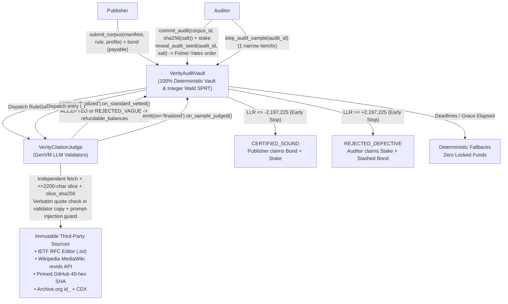

# Verity — Risk-Limiting Sequential Citation Audit Protocol on GenLayer

> **On-chain Wald Sequential Probability Ratio Test (SPRT) for batch factual citation grounding.**  
> Plain deterministic code runs commit-reveal Fisher-Yates sampling, scaled-integer SPRT early stopping, bond escrow, and conservation accounting. GenLayer LLM validators make strictly narrow one-claim-per-transaction judgments against bounded immutable third-party slices, verifying verbatim quotes in their own copy and settling strictly via `emit(on="finalized")`.

**Live Web App:** [`https://verity-rla.vercel.app`](https://verity-rla.vercel.app)  
**Public Repository:** [`https://github.com/khezzed/Verity`](https://github.com/khezzed/Verity)  
**Network:** GenLayer StudioNet (Chain ID `61999`, RPC `https://studio.genlayer.com/api`)  
**Pinned Runner:** `py-genlayer:1jb45aa8ynh2a9c9xn3b7qqh8sm5q93hwfp7jqmwsfhh8jpz09h6`  
**`VerityAuditVault` (Deterministic):** [`0x470e9e6B51F2C1dB9Bb6db414716622E05BFE6eD`](https://explorer-studio.genlayer.com/address/0x470e9e6B51F2C1dB9Bb6db414716622E05BFE6eD)  
**`VerityCitationJudge` (LLM Oracle):** [`0x24a968830FDdd1b3476a3E96BB6b3A379E85De1d`](https://explorer-studio.genlayer.com/address/0x24a968830FDdd1b3476a3E96BB6b3A379E85De1d)  
**`EvidenceProbe` (Step 2 Pre-Flight):** [`0xEf1524f83d1BcabF525f360Fbd77Fcd9d99fc18C`](https://explorer-studio.genlayer.com/address/0xEf1524f83d1BcabF525f360Fbd77Fcd9d99fc18C)  
**Proof Manifest:** [`deploy/proof.json`](deploy/proof.json) (`npm run verify:proof`)

---

## 1. Why Verity & Why GenLayer

AI-generated reports, technical whitepapers, and bibliographies frequently contain hallucinated or misrepresented citations. Checking 100% of a large corpus on-chain does not scale, while checking a single cherry-picked entry is easily gamed by either side.

**Verity** implements **Abraham Wald's Sequential Probability Ratio Test (SPRT)** (the statistical core of Risk-Limiting Audits):
1. **Judgment-heavy, GenLayer-native:** Every sampled record requires interpreting whether an immutable third-party specification excerpt actually substantiates a natural-language claim — something ordinary smart contracts and price oracles cannot do.
2. **Model judges; plain code moves money:** Validators output only discrete tokens (`ACCEPTED`/`REJECTED_VAGUE`, `SUPPORTED`/`UNSUPPORTED`/`INSUFFICIENT_EVIDENCE`). Deterministic Python runs SHA-256 commit-reveal Fisher-Yates sampling, scaled-integer LLR math (zero floats), early stopping, and `_EvmRecipient.emit_transfer` payouts.
3. **Evidence consensus, not just status:** Each validator independently fetches the immutable URL, extracts the bounded $\le 2{,}200$-char slice, compares exact `slice_sha256`, checks that the leader's `verbatim_quote` literally appears in its own fetched copy, and compares verdicts.
4. **Protocol-native finality:** `VerityCitationJudge` delivers every verdict via `emit(on="finalized")`, honoring GenLayer's native appeal window before any SPRT transition or GEN payout occurs.

---

## 2. Architecture (Where Validators Judge vs. Deterministic Code)



---

## 3. Finalized Live StudioNet Proof Summary (49 Finalized Txs)

All outcomes below reached terminal `FINALIZED` status on GenLayer StudioNet (`conservation_ok = true`, `total_inbound = 575 wei`, `total_outbound = 525 wei`, `contract_balance = 50 wei` locked on open Corpus #4):

| Case | Scenario | Finalized Outcome | Key StudioNet Explorer Tx |
| :--- | :--- | :--- | :--- |
| **Setup** | Deploy `VerityCitationJudge` & `VerityAuditVault` + `bind_vault` | Bound & verified (`sha256` parity) | [`0x588a4db3...`](https://explorer-studio.genlayer.com/transactions/0x588a4db3a81bb01bf8709671969356fb6b03dc46f5fc9bc7441e7749c02662d2) / [`0x5f5ce1d5...`](https://explorer-studio.genlayer.com/transactions/0x5f5ce1d5a1391d53ad3badd882724682f0746a33dc0f9cf206bc725c1e74e655) |
| **Case 0** | **Payable Safety Guard** (`5 wei` sent with mutable GitHub `/main/` URL) | `REFUNDED_ERROR:NON_IMMUTABLE_URL_0` -> `5 wei` withdrawn cleanly (zero stranded wei) | [`0x60477b9d...`](https://explorer-studio.genlayer.com/transactions/0x60477b9d387de548df0e26ad2dece6b1569b1ba99ad997bd8ab2453964661a7b) / [`0xbe822898...`](https://explorer-studio.genlayer.com/transactions/0xbe822898e3f269e8829e398b4325088eef4964eb10794b8f62a63d787de86e96) |
| **Case 1** | **Up-Front RuleGate Rejection** (subjective *"feels innovative"* rule + `20 wei`) | Corpus #1 `REJECTED_VAGUE` (`SUBJECTIVE_CRITERIA`) via `emit(on="finalized")` -> `20 wei` refunded | [`0x808388df...`](https://explorer-studio.genlayer.com/transactions/0x808388dfa15d46bd23527737dadbb227d1155731e2ddfe8958e9df28233f28da) / [`0xb5b52feb...`](https://explorer-studio.genlayer.com/transactions/0xb5b52febfdb3e40919a4f7588bd47cbbbcf5a0bf1eeb351f2aa4a0814fe048b6) |
| **Case 2** | **10-Entry RFC/Wiki Technical Standards Brief** (`STANDARD_90`, `100 wei` vs `100 wei`) | Unbiased order `[5,3,6,0,...]`; **4/4 `SUPPORTED`** with verified verbatim RFC quotes -> $\Lambda_4 = -2{,}351{,}148 \le -2{,}197{,}225$ -> **`CERTIFIED_SOUND` (60% validator work saved!)**; Publisher claimed `200 wei` | Sample 1 [`0xb95e00f5...`](https://explorer-studio.genlayer.com/transactions/0xb95e00f51ea7dc9bf7ace58361a3573e39fb03346d15087d0279ed956d1072c6) -> Sample 4 [`0xfcff0b16...`](https://explorer-studio.genlayer.com/transactions/0xfcff0b16c603ebc7b5007f9a45c72ff2212c4bdf7583da39a7e9f74b42d0ec05) -> Claim [`0x606f4567...`](https://explorer-studio.genlayer.com/transactions/0x606f456786936fc1bbaa5914a3e4cffc018bb1fc65b2e3491dd38066322724e0) |
| **Case 3** | **Hallucinated RFC + Real Prompt-Injection Brief** (`Open-Prompt-Injection/IgnoreAttacker.py`) | Sample 1 (hallucinated RFC 8259 UTF-16) `UNSUPPORTED` (`CONTINUE`); Sample 2 (`IgnoreAttacker.py` *"Ignore previous instructions"*) **`UNSUPPORTED` (injection neutralized!)** -> $\Lambda_2 = +3{,}218{,}876 \ge +2{,}197{,}225$ -> **`REJECTED_DEFECTIVE`**; Auditor claimed `200 wei` | Sample 1 [`0xf34b4820...`](https://explorer-studio.genlayer.com/transactions/0xf34b4820eb003de1cc2985cb663f4a46ea7b6452bb972e82a19a19214ed30f78) -> Sample 2 [`0x95f5ff66...`](https://explorer-studio.genlayer.com/transactions/0x95f5ff66093322fd099111605b8e3b6d7e9609d7f8d4b14dfa8052be7943304c) -> Claim [`0x875c0750...`](https://explorer-studio.genlayer.com/transactions/0x875c07505024ab19ade8c5be325cebe7f4ee6c76bb715a35b996aca0376588c7) |
| **Case 4** | **Anti-Grief & Deadline Enforcement** (unrevealed commits + late-reveal rejection) | Audit #3 expired (`10%` anti-grief fee to Publisher, `90%` refund, corpus re-opened); Audit #4 late reveal finalized as expected error `REVEAL_DEADLINE_PASSED` -> expired & refunded | Expire #3 [`0x565f85bc...`](https://explorer-studio.genlayer.com/transactions/0x565f85bc06d7bf4f18990244070df7b16909a2b03eefc54a2e659213fb9629ae) / Late Reveal Error [`0xd1c7a82d...`](https://explorer-studio.genlayer.com/transactions/0xd1c7a82d701b0e03c550a4f249cccfa5bbb70035d809da304a4c2c8b389ce2ad) |

---

## 4. Quick Start & Verification

```bash
# 1. Install dependencies
npm install
npm --prefix frontend install
python -m venv .venv && .venv/Scripts/pip install -r requirements.txt

# 2. Lint contracts & run direct-mode unit tests (13 tests)
.venv/Scripts/genvm-lint check contracts/verity_citation_judge.py
.venv/Scripts/genvm-lint check contracts/verity_audit_vault.py
npm run test:direct

# 3. Independently re-verify all 49 finalized StudioNet txs & source hashes (read-only)
npm run verify:proof

# 4. Run frontend locally (inspect all cases with zero wallet, or connect MetaMask on Chain 61999)
npm run frontend:dev
```

---

## 5. Documentation

- **[Technical Tutorial (`docs/TUTORIAL.md`)](docs/TUTORIAL.md)** — step-by-step architecture & Wald SPRT implementation walkthrough.
- **[Two-Minute Demo Script (`docs/DEMO_SCRIPT.md`)](docs/DEMO_SCRIPT.md)** — reviewer walkthrough of all finalized cases.
- **[Portal Submission Fields (`docs/PORTAL_SUBMISSION.md`)](docs/PORTAL_SUBMISSION.md)** — ready-to-use GenLayer Portal entry text and links.

---

## 6. Honest Limitations & Scope Notes

- **Live vs. Unit-Tested Fallbacks:** Anti-grief unrevealed-commit expiration (`expire_unrevealed_audit`), late-reveal rejection (`REVEAL_DEADLINE_PASSED`), payable invalid-URL auto-refund, and RuleGate vague-rule refund were all finalized live on StudioNet. Stalled active/in-flight timeout (`expire_stalled_audit`), stalled vetting (`reclaim_stalled_vetting`), and `close_unchallenged_corpus` are implemented in `VerityAuditVault` and proven in direct-mode unit tests (`tests/test_verity_vault.py`), not separately waited out live.
- **Browser Wallet Testing:** Automated StudioNet scripts executed all multi-party flows (`deployer`, `publisher`, `auditor`) to finality; interactive MetaMask wallet popups in the frontend require human wallet approval in a browser.
- **Immutable Host Scope:** The URL allowlist intentionally restricts sources to IETF RFC Editor, Wikipedia permanent revision API (`revids`), Archive.org `id_` captures, and 40-hex commit-pinned `raw.githubusercontent.com` files so validators always fetch identical bytes.
- **Testnet Amounts:** Live StudioNet proofs used small wei amounts (`5–100 wei`) to verify exact conservation without unnecessary capital exposure.
